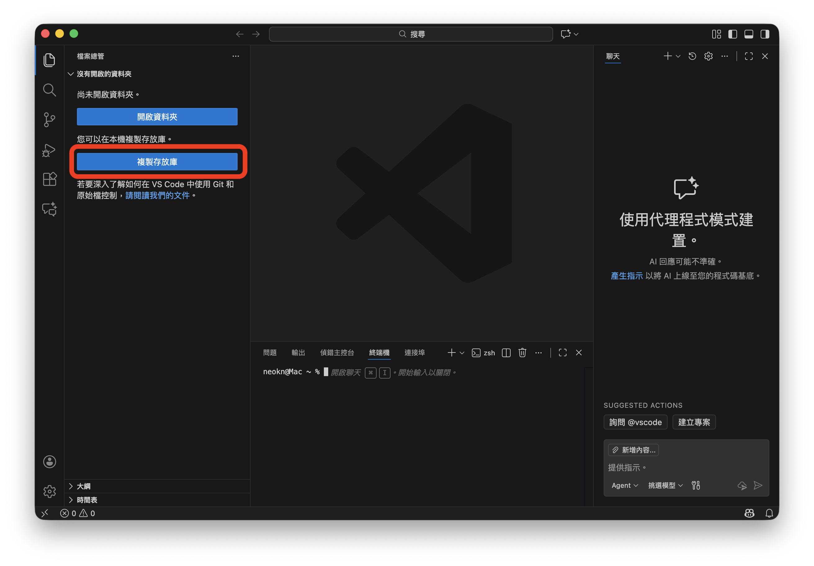

# Workshop 前置作業

熟悉 Terminal 操作的朋友可以直接到 [快速上路](#快速上路) 看看

## 新手上路

### VSCode
以下教學會以 VSCode 為範例
如果還沒有 VSCode 可以到 [VSCode](https://code.visualstudio.com/) 下載

### 複製存放庫



> https://github.com/neokn/google-devfest-taipei-2025


### 安裝 Node.js
[Node.js](https://nodejs.org/zh-tw/download)

依照你的作業系統選擇對應的安裝檔


點選右上角**切換面板**按鍵
確認有選在**終端機**

在終端機輸入 `npm i`

## 快速上路

專案兼容 `npm`, `pnpm`, `yarn`, `bun`
可以選自己習慣的

```bash
git clone https://github.com/neokn/google-devfest-taipei-2025.git
cd google-devfest-taipei-2025
npm i
```
